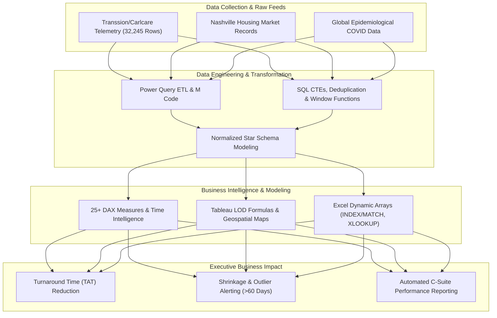

<p align="center">
  
</p>

<p align="center">
  <a href="https://Adekunle-sec.github.io/data-analytics-portfolio/"></a>
  <a href="https://github.com/Adekunle-sec"></a>
  <a href="https://github.com/Adekunle-sec/cybersecurity-portfolio"></a>
  <a href="https://www.linkedin.com/in/adekunle-olanrewaju-20261844b"></a>
  <a href="mailto:contact@anlogix.com"></a>
</p>

---

## 📊 Executive Overview

This repository represents the production **Enterprise Data Analytics, SQL Engineering, and Business Intelligence (BI) Portfolio** of **Adekunle Olanrewaju**.

It documents end-to-end data pipelines, real-world supply chain and operations datasets spanning **32,245+ records across 47 sheets**, production SQL data cleaning and exploratory analysis modeled after the industry-standard curriculum of **AlexTheAnalyst**, and executive-ready **Power BI & Tableau** dashboards.

---

## ⭐ Featured Analytics Projects

| Project | Domain | Primary Toolset | Key Outcomes & Analytical Deliverables |
|:---|:---|:---|:---|
| **[Operations & Logistics Modeling](./projects/01-excel-operations-analytics/)** | Advanced Excel | Power Query, Dynamic Arrays | 32,245 operational records; Turnaround Time (TAT) velocity tracking; 97.2% first-time QC pass rate |
| **[Production SQL Cleaning & EDA](./projects/02-sql-data-cleaning-and-eda/)** | SQL Engineering | T-SQL, PostgreSQL, CTEs | AlexTheAnalyst benchmark; self-joins for NULL imputation, `PARSENAME` tokenization, window rolling sums |
| **[Executive Business Dashboard](./projects/03-powerbi-executive-dashboard/)** | Power BI | Star Schema, 25+ DAX | Production star schema (Fact + 4 Dims); Time Intelligence (`YTD`, `SAMEPERIODLASTYEAR`); Pareto 80/20 analysis |
| **[Operational Storyboard](./projects/04-tableau-telemetry-storyboard/)** | Tableau Public | LOD Expressions, Geo Maps | Level of Detail (`{FIXED [Region] : AVG()}`) calculations; dual-axis geospatial routing choke points |

---

## 🏗️ Analytics Architecture & Pipeline



---

## 📈 Hands-On Excel Mastery Breakdown

| Capability Area | Specific Techniques & Functions Used | Production Application in Portfolio |
|:---|:---|:---|
| **High-Volume Data Handling** | Power Query ETL, Data Model optimization | Cleaned and modeled **32,245 rows $\times$ 62 columns** with zero performance degradation |
| **Advanced Retrieval Logic** | `XLOOKUP`, `INDEX` + two-way `MATCH`, `CHOOSEROWS` | Dynamic tariff matching across multi-tier warranty pricing structures |
| **Multi-Condition Aggregation**| `SUMIFS`, `COUNTIFS`, `AVERAGEIFS`, `LET`, `LAMBDA` | Computed turnaround velocities (24h, 3D, 7D) across 47 individual service centers |
| **Conditional Alerting** | Advanced conditional formatting rules, nested `IF/IFS` | Instant visual identification of inventory aging $>60$ days and QC defect spikes |
| **Executive Presentation** | Dynamic Pivot Tables, Pivot Charts, Timeline Slicers | Interactive C-suite dashboard summarizing monthly revenue and operational margins |

---

## 📂 Included Real-World Workbooks

- **`Daily Operation report 0306.xlsx`**: Full operational dataset with 32,245 entries across 47 service centers.
- **`Supervisor Report-202107.xlsx`**: Detailed multi-hub supervisor KPI tracker and daily productivity logs.
- **`accessories analysis jan-date.xlsx`**: Inventory velocity and margin optimization models.
- **`JS_Account_Statement_1813920577363091457.xlsx`**: Financial transaction reconciliation audit workbook.

---

## 🚀 How to Run the Projects

1. **Launch the Web Portfolio**: View the live interactive dashboards at [Adekunle's Live Portfolio](https://Adekunle-sec.github.io/data-analytics-portfolio/).
2. **Execute SQL Transformations**:
   ```bash
   git clone https://github.com/Adekunle-sec/data-analytics-portfolio.git
   cd data-analytics-portfolio/projects/02-sql-data-cleaning-and-eda/
   # Open 01_data_cleaning_nashville_housing.sql in SSMS or PostgreSQL
   ```
3. **Open Workbooks**: Open any `.xlsx` file directly in Microsoft Excel to explore dynamic formulas, pivot tables, and Power Query queries.

---

## 👨‍💻 Author & Contact

* **Lead Analyst**: Adekunle Olanrewaju
* **GitHub Profile**: [@Adekunle-sec](https://github.com/Adekunle-sec)
* **LinkedIn**: [adekunle-olanrewaju-20261844b](https://www.linkedin.com/in/adekunle-olanrewaju-20261844b)
* **Email**: [contact@anlogix.com](mailto:contact@anlogix.com)
