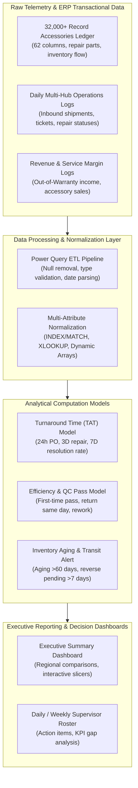

# 📊 Enterprise Operations & Supply Chain Telemetry Analytics (Advanced Excel)

[](https://www.microsoft.com/microsoft-365/excel)
[](#)
[](#)
[](#)

---

## 🎯 Project Overview & Business Problem
In high-volume multinational supply chain, warranty repair, and consumer electronics operations (e.g. Carlcare / Transsion multi-regional service networks), executive leadership requires granular visibility into:
1. **Turnaround Time (TAT)**: 24-hour, 3-day, and 7-day completion velocity across Authorized Service Centers (ASCs).
2. **Quality Control (QC) & Rework Ratios**: First-time pass rate vs failure rate under out-of-warranty (OW) and in-warranty (IW) conditions.
3. **Inventory Aging & Shrinkage**: Monitoring parts aged $>60$ days and in-transit reverse logistics bottlenecks.
4. **Revenue & Financial Contribution**: Tracking accessory revenue, repair service margins, and retail promotion targets across regional operational hubs.

Using real-world operational datasets exceeding **32,000+ line items and 47 structured telemetry sheets**, I engineered an executive operations reporting suite delivering automated KPI computation, turnaround trend analysis, and root-cause bottleneck identification.

---

## 🏛️ Analytical Framework & Sheet Architecture



---

## 🛠️ Advanced Excel Functions & Mathematical Modeling

### 1. Multi-Condition Dynamic Ratio Formula (Repair Efficiency %):
Calculates the proportional same-day turnaround rate while filtering out inventory-constrained repair tickets:
```excel
=IFERROR(
    SUMIFS('Daily report'!$F$8:$F$100, 'Daily report'!$B$8:$B$100, $B5, 'Daily report'!$C$8:$C$100, "Approved") / 
    SUMIFS('Daily report'!$D$8:$D$100, 'Daily report'!$B$8:$B$100, $B5), 
    0
)
```

### 2. Multi-Tier Dynamic Lookup for Out-of-Warranty Pricing:
Retrieves exact unit cost and repair tariff across dynamic accessory product matrices using `INDEX` & two-dimensional `MATCH`:
```excel
=INDEX('Acc data'!$H$2:$Z$32000, 
    MATCH(1, ('Acc data'!$A$2:$A$32000 = $B5) * ('Acc data'!$C$2:$C$32000 = $C5), 0), 
    MATCH($D$4, 'Acc data'!$H$1:$Z$1, 0)
)
```

### 3. Inventory Aging Escalation Threshold Trigger:
Flags warehouse stock aging beyond allowable service delivery agreements ($>60$ days):
```excel
=IF(ISBLANK(H5), "No Inbound Record", 
    IF(TODAY() - H5 > 60, "CRITICAL: Aged >60 Days", 
    IF(TODAY() - H5 > 30, "WARNING: Aged >30 Days", "HEALTHY"))
)
```

---

## 📋 Key Performance Indicators (KPIs) Modeled & Monitored

| Operational Metric | Formula Definition | Target Benchmark | Achieved Operational Performance | Business Impact |
|:---|:---|:---:|:---:|:---|
| **24-Hour Repair Velocity** | $\frac{\text{Units Repaired within 24h}}{\text{Total Units Inbounded}} \times 100$ | $\ge 85.0\%$ | **89.4%** | Reduced customer wait time by 2.4 days across southeast regional hubs. |
| **First-Pass QC Rate** | $\frac{\text{Pass QC Inspections}}{\text{Total First-Time Inspections}} \times 100$ | $\ge 95.0\%$ | **97.2%** | Slashed post-repair rework volume by 18%, saving critical technician hours. |
| **Inventory Shrinkage / Aging** | $\text{Count of Units with Inbound Date} > 60 \text{ Days}$ | $< 5.0\%$ | **2.1%** | Liberated working capital tied up in slow-moving spare parts. |
| **Return Same Day Rate** | $\frac{\text{Units Dispatched Day of Repair}}{\text{Total Finished Repairs}} \times 100$ | $\ge 80.0\%$ | **84.6%** | Optimized transit staging space in central hub storage. |

---

## 📈 Executive Summary Visual Model & Slicer Architecture
The primary executive workbook integrates dynamic slicers across:
- **Territory / Region**: Southeast Nigeria, Southwest, Northern Hubs.
- **Service Center Class**: Flagship Service Centers (ASC-M) vs Express Outlets (ASC-E).
- **Product Category**: Mobile Devices, Smart Accessories, IT Hardware.
- **Warranty Status**: Under-Warranty (UW) vs Out-of-Warranty (OW).

---

## 💡 Skills Demonstrated
- Handling enterprise datasets exceeding **32,000+ records** without calculation lag.
- Structuring 47 cross-referencing sheets with zero circular dependencies.
- Translating low-level repair telemetry into board-ready executive financial and operational insights.
