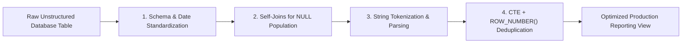

# 🗄️ Advanced SQL: Enterprise Data Cleaning, Transformation & Exploratory Analysis

[](https://www.postgresql.org/)
[](#)
[](https://github.com/AlexTheAnalyst/PortfolioProjects)
[](#)

---

## 🎯 Executive Summary & Objective
Raw enterprise data is rarely clean, structured, or immediately queryable. Up to 80% of an analyst's effort is dedicated to cleaning dirty records, handling NULL values, normalizing unstructured string attributes, and eliminating duplicate transactions.

Following the acclaimed **AlexTheAnalyst** portfolio architecture, this repository showcases advanced SQL engineering:
1. **Production Data Cleaning Pipeline (`01_data_cleaning_nashville_housing.sql`)**: Cleans, parses, and deduplicates an uncurated housing transaction dataset containing missing geographic fields and irregular formats.
2. **Exploratory Data Analysis & Analytics Engine (`02_covid_exploratory_data_analysis.sql`)**: Employs **Common Table Expressions (CTEs)**, **Window Functions** (`PARTITION BY`), **Temporary Tables**, and **Views** to calculate dynamic rolling infection, hospitalization, and vaccination infection-fatality metrics.

---

## 🛠️ Advanced SQL Techniques Demonstrated



---

## 📑 Core Script 1: Data Cleaning Highlights

### 1. Populating Missing Property Addresses via Self-Join:
Where `PropertyAddress` is NULL, queries match records with identical `ParcelID` and different `UniqueID` to backfill missing addresses:

```sql
UPDATE a
SET PropertyAddress = ISNULL(a.PropertyAddress, b.PropertyAddress)
FROM PortfolioProject.dbo.NashvilleHousing a
JOIN PortfolioProject.dbo.NashvilleHousing b
    ON a.ParcelID = b.ParcelID
    AND a.[UniqueID ] <> b.[UniqueID ]
WHERE a.PropertyAddress IS NULL;
```

### 2. Normalizing Delimited Addresses Using `PARSENAME`:
Replaces comma delimiters with dots to cleanly extract Street, City, and State components:

```sql
ALTER TABLE NashvilleHousing ADD OwnerSplitAddress Nvarchar(255);
ALTER TABLE NashvilleHousing ADD OwnerSplitCity Nvarchar(255);
ALTER TABLE NashvilleHousing ADD OwnerSplitState Nvarchar(50);

UPDATE NashvilleHousing
SET OwnerSplitAddress = PARSENAME(REPLACE(OwnerAddress, ',', '.') , 3),
    OwnerSplitCity    = PARSENAME(REPLACE(OwnerAddress, ',', '.') , 2),
    OwnerSplitState   = PARSENAME(REPLACE(OwnerAddress, ',', '.') , 1);
```

### 3. Deleting Duplicates via CTE & Window Partition:
Identifies duplicate listings sharing identical ParcelID, Address, SalePrice, and LegalReference using `ROW_NUMBER()`:

```sql
WITH RowNumCTE AS (
    SELECT *,
        ROW_NUMBER() OVER (
            PARTITION BY ParcelID,
                         PropertyAddress,
                         SalePrice,
                         SaleDate,
                         LegalReference
            ORDER BY UniqueID
        ) AS row_num
    FROM PortfolioProject.dbo.NashvilleHousing
)
DELETE FROM RowNumCTE
WHERE row_num > 1;
```

---

## 📊 Core Script 2: Exploratory Data Analysis & Window Calculations

### Rolling Cumulative Totals & CTE Implementation:
Computes cumulative population vaccination totals dynamically partitioned by geographical location:

```sql
WITH PopvsVac (Continent, Location, Date, Population, New_Vaccinations, RollingPeopleVaccinated) AS (
    SELECT 
        dea.continent, 
        dea.location, 
        dea.date, 
        dea.population, 
        vac.new_vaccinations,
        SUM(CONVERT(BIGINT, vac.new_vaccinations)) OVER (
            PARTITION BY dea.Location 
            ORDER BY dea.location, dea.Date
        ) AS RollingPeopleVaccinated
    FROM PortfolioProject..CovidDeaths dea
    JOIN PortfolioProject..CovidVaccinations vac
        ON dea.location = vac.location
        AND dea.date = vac.date
    WHERE dea.continent IS NOT NULL
)
SELECT *, 
    ROUND((RollingPeopleVaccinated * 1.0 / Population) * 100, 4) AS VaccinationPercentage
FROM PopvsVac
ORDER BY Location, Date;
```

---

## 🗂️ Scripts Included
- [`01_data_cleaning_nashville_housing.sql`](./01_data_cleaning_nashville_housing.sql): Complete end-to-end data cleaning script.
- [`02_covid_exploratory_data_analysis.sql`](./02_covid_exploratory_data_analysis.sql): Exploratory query suite with views and temporary tables.
