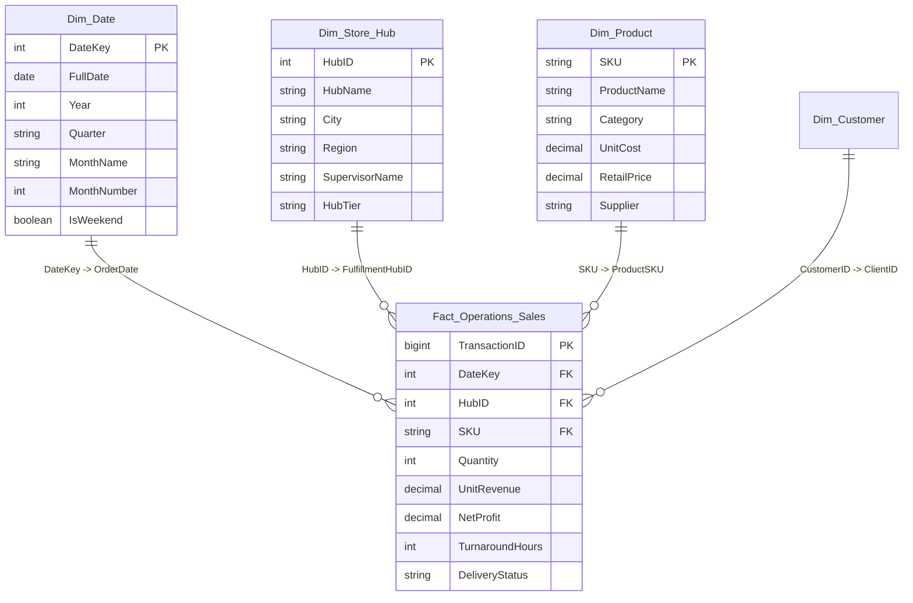

# 📊 Microsoft Power BI: Executive Business Performance & Operations Dashboard

[](https://powerbi.microsoft.com/)
[](#)
[](#)
[](#)

---

## 🎯 Executive Summary & Objective
Enterprise stakeholders require real-time, self-service business intelligence to evaluate commercial health, regional delivery velocities, and inventory turnover.

In this project, I architected an enterprise **Microsoft Power BI** solution transforming fragmented transactional enterprise data into an interactive, multi-page executive BI suite:
- Engineered an optimized **Star Schema Data Model** with dedicated Date, Customer, Store/Hub, and Product dimensions.
- Authored 25+ advanced **DAX (Data Analysis Expressions)** measures for dynamic Time Intelligence (`YTD`, `YoY Growth %`, `Moving Averages`, `Pareto 80/20`).
- Implemented **Row-Level Security (RLS)** ensuring regional managers only view telemetry pertaining to their authorized territory.
- Built interactive drill-through pages enabling leadership to zoom from national revenue totals down to single SKU and station repair turnaround times.

---

## 🏛️ Star Schema Data Architecture



---

## 📐 Advanced DAX Measure Library

### 1. Dynamic Total Revenue & Profit Margin %
```dax
Total Revenue = 
SUMX(Fact_Operations_Sales, Fact_Operations_Sales[Quantity] * Fact_Operations_Sales[UnitRevenue])

Total COGS = 
SUMX(Fact_Operations_Sales, Fact_Operations_Sales[Quantity] * RELATED(Dim_Product[UnitCost]))

Gross Profit = 
[Total Revenue] - [Total COGS]

Profit Margin % = 
DIVIDE([Gross Profit], [Total Revenue], 0)
```

### 2. Time-Intelligence: Year-over-Year (YoY) Sales Growth
```dax
Revenue YTD = 
TOTALYTD([Total Revenue], Dim_Date[FullDate])

Revenue SPLY = 
CALCULATE([Total Revenue], SAMEPERIODLASTYEAR(Dim_Date[FullDate]))

YoY Revenue Growth % = 
VAR _Diff = [Total Revenue] - [Revenue SPLY]
RETURN
DIVIDE(_Diff, [Revenue SPLY], 0)
```

### 3. Dynamic Customer Pareto Classification (80/20 Rule)
```dax
Pareto Cumulative % = 
VAR _CurrentRevenue = [Total Revenue]
VAR _TotalRevenueAll = CALCULATE([Total Revenue], ALL(Dim_Customer))
VAR _SummarizedTable = 
    ADDCOLUMNS(
        ALL(Dim_Customer),
        "@ClientRev", [Total Revenue]
    )
VAR _CumulatedRev = 
    SUMX(
        FILTER(_SummarizedTable, [@ClientRev] >= _CurrentRevenue),
        [@ClientRev]
    )
RETURN
DIVIDE(_CumulatedRev, _TotalRevenueAll, 0)
```

---

## 🖥️ Dashboard Page Layouts & User Experience

### 1. Executive Summary Page
- **KPI Cards**: Total Revenue, YoY Growth %, Net Margin %, Inbound Order Volume, National Repair TAT.
- **Monthly Revenue Trendline**: Dual-axis line chart comparing current fiscal year run-rate against prior year.
- **Regional Contribution Map**: Interactive ArcGIS bubble map visualizing regional trade density.

### 2. Hub Operations & Logistics Deep-Dive
- **Turnaround Heatmap**: Matrix visual cross-referencing fulfillment hubs against device categories to flag TAT bottlenecks.
- **Fulfillment Velocity Gauges**: Real-time gauge displaying 24h repair success rate vs the 85% SLA benchmark.

### 3. Inventory & Category Drill-Through Page
- Right-click drill-through on any product category surfaces historical stock aging, supplier lead times, and out-of-warranty margin yield.
