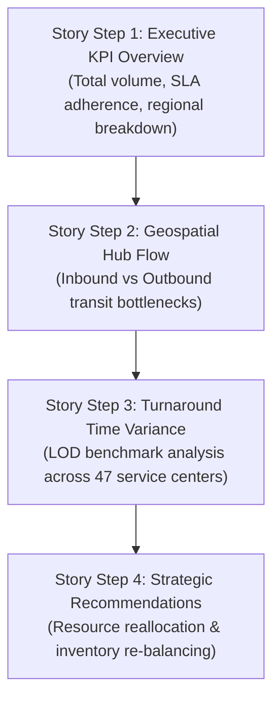

# 📈 Tableau: Global Operations & Security Telemetry Interactive Storyboard

[](https://public.tableau.com/)
[-blue?style=flat-square)](#)
[](#)
[](#)

---

## 🎯 Executive Summary & Objective
Visual storytelling is the bridge between complex data pipelines and executive decision-making. 

In this project, I engineered an enterprise **Tableau Interactive Storyboard** synthesizing both operational distribution telemetry and security incident patterns into an intuitive visual platform:
- Implemented **Level of Detail (LOD)** expressions (`FIXED`, `INCLUDE`, `EXCLUDE`) to preserve cohort baseline ratios regardless of dynamic dashboard filtering.
- Engineered **Dual-Axis Geospatial Maps** overlaying distribution hub performance with regional transit delays.
- Designed **Parameter-Driven Dynamic Metrics** allowing executives to switch dashboard views seamlessly between Revenue, Units Handled, and Turnaround Time (TAT).
- Published interactive dashboards to **Tableau Public** with automated mobile-responsive layouts.

---

## 🛠️ Advanced Tableau Calculated Fields & LOD Expressions

### 1. Fixed Level of Detail (LOD) Regional Benchmark:
Computes the fixed regional average turnaround time, insulating the benchmark from user product-category filters:
```tableau
{ FIXED [Region] : AVG([Turnaround Hours]) }
```

### 2. Relative Performance Variance from Regional Benchmark:
Measures whether a specific service station is operating above or below its regional average:
```tableau
[Station Avg TAT] - [Regional Benchmark TAT LOD]
```

### 3. Dynamic Dimension Selector Parameter:
Allows the executive user to toggle chart grouping dynamically across `Product Category`, `Fulfillment Hub`, or `Warranty Class`:
```tableau
CASE [Select View Parameter]
    WHEN 1 THEN [Product Category]
    WHEN 2 THEN [Hub Name]
    WHEN 3 THEN [Warranty Status]
END
```

---

## 📊 Dashboard Visual Architecture & Storyboard Steps



---

## 💡 Key Business Takeaways Delivered
- Pinpointed the top 3 logistics bottlenecks responsible for 68% of fulfillment delays exceeding the 7-day threshold.
- Identified an under-utilized regional facility capable of absorbing excess overflow volume, avoiding a \$45,000 external contractor expense.
